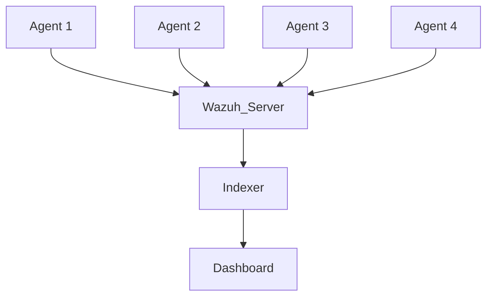
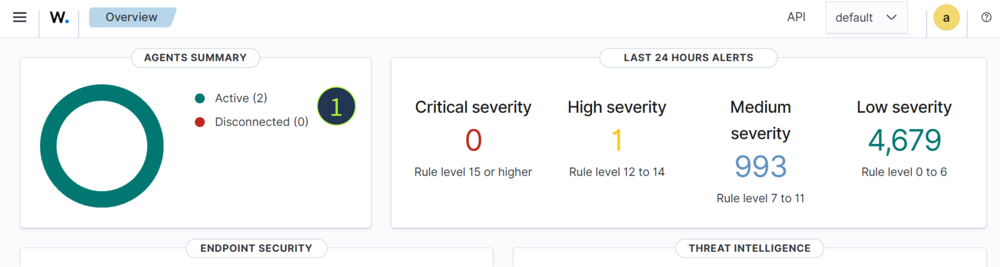
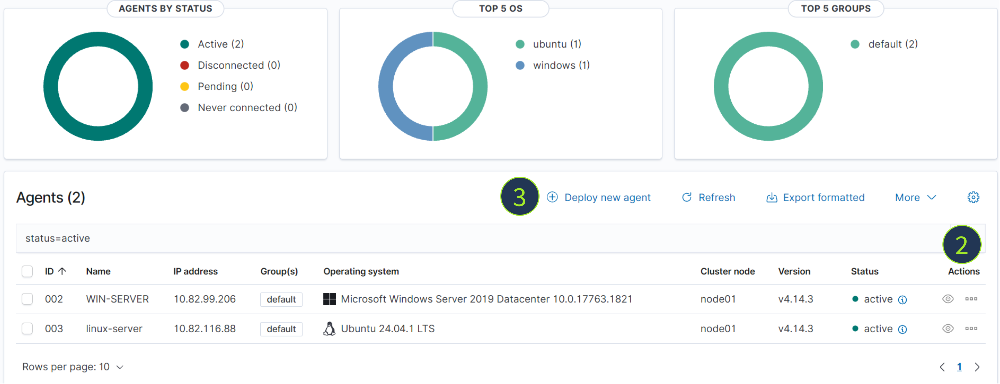

# Exploring Wazuh

> 🔗 [Room Link](https://tryhackme.com/room/exploringwazuh)

---

## Task 1 — Intro

Wazuh has come a long way since its early days as a basic intrusion detection system. Over the years, it has grown into a **unified security platform** that SOC analysts, sysadmins, and GRC teams can effectively use. In this room, you will learn what Wazuh is, and how to use it for all kinds of compliance and security monitoring tasks.

### Prerequisites

- **Elastic Stack: The Basics** room will make it easier for you to use the lab machine
- **GRC and SOC knowledge** will help you understand the problems Wazuh solves

### What Is Wazuh?

While it started as an EDR/HIDS-focused tool, Wazuh has grown into a unified security platform that combines **endpoint detection and response**, **event management**, **vulnerability assessment**, and **cloud security monitoring** under one roof. It goes well beyond traditional EDR by:

- Auditing devices for common vulnerabilities
- Monitoring for suspicious activity on the endpoints
- Visualizing complex events into neat dashboards and graphs
- Providing compliance reporting for frameworks like **GDPR**, **HIPAA**, and **NIST**

---

## Task 2 — Launch Wazuh Server

### Wazuh Architecture



Founded in 2015, Wazuh is used across organizations of all sizes — from small businesses to large enterprises and government institutions. Wazuh operates on a **manager and agent model**: one Wazuh server (manager) stores and processes the data, while many hosts (agents) send data to the manager.

In more technical terms, the Wazuh server consists of multiple components:
- An **indexer** built on top of OpenSearch (a fork of Elasticsearch)
- A custom-built **orchestrator** (manager)
- **Filebeat** — sends data from the manager to the indexer
- A **GUI** built on top of OpenSearch Dashboards

> In this room, all components are installed on a single VM.

### Lab Setup

Deploy the Wazuh management server attached to this task and wait **4–5 minutes** before visiting the Wazuh server. Once it has started, log in using the following credentials:

| Field    | Value                                  |
|----------|----------------------------------------|
| URL      | `https://LAB_WEB_URL.p.thmlabs.com:8443` |
| Username | `thmuser`                              |
| Password | `TryHackMe!`                           |

Once you log in, you should see the **Overview page** with two agents installed.

> **Note:** The agents will be in the **Disconnected** state in your lab — this is expected.


---

## Task 3 — Installing Wazuh Agents

### Wazuh Agents

Agents monitor the events that take place on the device, such as **authentication** and **OS activities**; they also audit the device for misconfigurations and much more.

From the Overview page, click on the **"Disconnected"** keyword in the Agents Summary panel:



You should now see the main **Agents** menu. Feel free to explore agents' details using the **Actions** menu, or see the instructions for deploying new agents. Wazuh agents support **Windows**, **Linux**, and **macOS**, and are fairly easy to install by following the documentation.



### Agent Groups

When deploying an agent, you need to specify:
- The **IP address** of your Wazuh server
- The **agent name** (typically the same as the hostname)
- The **group**

Agents can be organized into groups, each of which can contain specific audit policies and logging settings. For example:

| Group  | Purpose                          |
|--------|----------------------------------|
| `CORP` | Corporate servers and desktops   |
| `BYOD` | Personal/bring-your-own devices  |


### ❓ Questions

- What is the status of the agents managed by this Wazuh?
- Click on the Windows agent. What is the CPU field value?

---

## Task 4 — Configuration Assessment

Once the agent is installed, Wazuh runs lots of security checks and collects a ton of information about the host. One of the most useful categories for IT is the **IT Hygiene** checks.

Select the **WIN-SERVER** agent, click **More**, and open the **IT Hygiene** section. Once there, you will see multiple tabs:

| Tab          | Description                                                                    |
|--------------|--------------------------------------------------------------------------------|
| **System**   | Hardware, hostname, network interfaces, and OS version                         |
| **Software** | Installed programs, OS patches, and browser extensions                         |
| **Network**  | Listening ports (e.g., RDP) — vital for Exposure Management                   |
| **Identity** | Local users present on the device, including their privileges                  |


### Wazuh and CIS Benchmarks

Wazuh is capable of auditing and monitoring an agent's configuration with **CIS benchmarks** or even custom checklists. When the Wazuh agent is installed on a Windows machine, it runs **347 CIS security checks** (typically PowerShell commands) and verifies the results. You can use it to audit your devices for misconfigurations and prepare them for audit.

Select the **WIN-SERVER** agent and open its **Configuration Assessment** panel to get started:


### ❓ Questions

- Open the Windows agent and navigate to its IT Hygiene tab.  
  What custom text editor is installed there (**Software > Packages**)?

- Open the Linux agent and its Configuration Assessment tab.  
  What is the CIS Benchmark score of the Linux agent (e.g., `65%`)?

---

## Task 5 — Vulnerability Detection

### Wazuh and Vulnerability Detection

Wazuh's **Vulnerability Detection** module periodically scans an agent for vulnerable applications. Out of the box, it is quite sensitive — for example, a fresh Ubuntu server may report **1293+ vulnerabilities**, including 3 critical ones.

> While the information is technically correct, only a few reported vulnerabilities can actually be exploited. IT administrators must decide what to patch on their own.


Wazuh reevaluates vulnerabilities periodically and every time a new package is installed. You can sort and filter vulnerabilities by:

- **Timestamp**
- **CVE number**
- **Package name**
- **Description**

For example, to filter for **Linux kernel** vulnerabilities, select the **linux-server** agent, go to the **Inventory** subtab, and filter for:

```
package.name IS linux-aws
```


### ❓ Questions

- What is the latest Notepad++ vulnerability found on the Windows agent?  
  *(Provide the most recent CVE number, e.g., `CVE-2026-23569`)*

- What is the earliest critical vulnerability found on the Linux agent?  
  *(Provide the oldest CVE number, e.g., `CVE-2015-3719`)*

---

## Task 6 — Logging and Reporting

### Logging With Wazuh

The core Wazuh capability is to collect and parse **security logs** from the agents. With some tweaks, Wazuh becomes a powerful SIEM, similar to Elasticsearch and Kibana.

To check authentication logs from the **linux-server**:

1. Open **top-left menu** > **Explore** dropdown > **Discover**

This is the panel where all raw logs can be viewed, including configuration assessment and vulnerability detection results.


### Discover Menu Overview

| # | Element | Description |
|---|---------|-------------|
| 1 | Index pattern selector | Field search — useful to learn which fields are present in events |
| 2 | Search query input | Time selector — use `decoder.name: sshd` with time range `Last 5 years` for SSH logins |
| 3 | Events panel | Expand each event by clicking the toggle near the timestamp |


### Logs vs Rules vs Alerts

In Wazuh, there is no concept of traditional SIEM logs. Instead:

- You define **what logs become alerts** using Wazuh rules
- All **non-matching events are discarded**
- Wazuh has hundreds of **prebuilt rules** for different OS data sources
- Rules have a **severity level from 1 to 15**, where **15 is the most critical**

### Dashboards and Reports

To create a custom visualization:

1. **Top-left menu** > **Explore** > **Visualize** > **Create Visualization**
2. Select **Pie** chart
3. Choose the `wazuh-alerts-*` source
4. Add the **Split slices** bucket and aggregate by `agent.name`
5. Click **Update** (set time range to `Last 5 years`)


*Building custom visualizations*

You can combine multiple visualization panels into a single dashboard. Explore the **Demo Dashboard** via:
**Top-left menu** > **Explore** > **Dashboards**

### ❓ Questions

- Navigate to Discover and search for Defender alerts for the last 5 years using query:  
  `data.win.system.eventID: 1116`  
  What is the **threat name** of the detected malware?

- Navigate to the **Demo Dashboard**.  
  How many total events are shown?

---

## Task 7 — Custom Log Collection

### Agent Configuration

Wazuh collects basic system logs by default. To collect **custom logs**, specify requirements in the **Groups** menu — they automatically propagate to all active agents.

Navigate to: **Agents management** > **Groups** > click the pencil icon


**Example: Adding Sysmon log collection for Windows**

```xml
<localfile os="Windows">
  <location>Microsoft-Windows-Sysmon/Operational</location>
  <log_format>eventchannel</log_format>
</localfile>
```

### Wazuh Decoders

Decoders instruct Wazuh on **how to parse** incoming raw data, since every source sends events in its own unique format. Hundreds of default decoders are available under **Server management** > **Decoders**.

**Example: Sysmon Event Code 1 Decoder**

```xml
<decoder name="Sysmon-EventID#1">
    <parent>windows</parent>
    <type>windows</type>
    <prematch>INFORMATION\(1\).+HashType</prematch>
    <regex>Image: (\.*) \s*CommandLine: \.* \s*User: (\.*) \s*LogonGuid: \S* \s*LogonId: \S* \s*TerminalSessionId: \S* \s*IntegrityLevel: \.*HashType: \S* \s*Hash: (\S*) \s*ParentProcessGuid: \S* \s*ParentProcessID: \S* \s*ParentImage: (\.*) \s*ParentCommandLine:</regex>
    <order>sysmon.image,srcuser,sysmon.hash,sysmon.parentImage</order>
</decoder>
```

### Wazuh Rules

Parsed logs must become **alerts** to be visible in the Wazuh dashboard. Rules define what triggers an alert.

**Example: PowerShell Execution Detection Rules**

```xml
<group name="sysmon,">
  <rule id="184665" level="0">
    <if_sid>18100</if_sid>
    <match>Microsoft-Windows-Sysmon/Operational: INFORMATION(1)</match>
    <description>Sysmon - Event Code 1</description>
    <group>sysmon_event1,</group>
  </rule>
  <rule id="255000" level="12">
    <if_group>sysmon_event1</if_group>
    <field name="sysmon.image">\\powershell.exe</field>
    <description>Sysmon Alert - PowerShell Launch</description>
    <group>sysmon_event1,powershell_execution,</group>
  </rule>
</group>
```

> Rule levels: `0` = informational, `12` = high importance, `15` = critical

### Alert Notifications

You can configure notifications when rules are triggered:

1. Write a query: `rule.level >= 12`
2. Create an alert in **Explore** > **Alerting**
3. Set up a notification channel (e.g., **Slack** or **email**)

You will receive a notification every time your query matches new events.


### ❓ Questions

- How do you call the Wazuh element that extracts fields from raw logs?

- What Wazuh alert is more critical — one with `rule.level` set to **10** or **15**?

---

## Task 8 — Unique Wazuh Features

### Summary of Explored Features

**For IT and GRC teams:**

| Feature | Description |
|---------|-------------|
| **Vulnerability Detection** | Track software vulnerabilities on agents |
| **Configuration Assessment** | Track security misconfigurations on agents |
| **IT Hygiene** | View agent details, installed apps, and browser extensions |

**For SIEM capabilities:**

| Feature | Description |
|---------|-------------|
| **Decoders and Rules** | Ingest and monitor OS and application logs |
| **Discover and Dashboards** | Search and visualize ingested logs |

---

### Wazuh Active Response

In response to received events, Wazuh can send a **response command** ([Active Response](https://documentation.wazuh.com/current/user-manual/capabilities/active-response/index.html)) to the agent:

- Run a script
- Delete a file
- Block a network connection
- And more

> **Note:** The response is executed with a delay (up to a few minutes) and therefore **cannot fully replace real-time EDR features**. Still, Active Response can be used as an **RMM/MDM** for mass software deployment or to support existing AV/EDR solutions.


---

### File Integrity Monitoring (FIM)

Many government regulations require organizations to monitor critical files for unauthorized changes, including:
- OS configurations
- Application settings
- VPN profiles

Wazuh addresses these needs through its **File Integrity Monitoring** ([FIM](https://documentation.wazuh.com/current/user-manual/capabilities/file-integrity/index.html)) module, which logs every modification to selected files, directories, and **registry keys on Windows**.

Explore it under: **Endpoint Security** > **File Integrity Monitoring**


---

### FIM and Malware Detection

Wazuh goes beyond basic file monitoring with two built-in malware detection features:

| Feature | How it works |
|---------|--------------|
| **YARA Integration** | Scans monitored files using your own YARA rules |
| **VirusTotal Integration** | Checks file hashes against VirusTotal's database |

A match triggers an **alert** and optionally an **Active Response** to contain the threat.

> **Note:** You must bring your own YARA rules and VirusTotal API key to enable these features.

---

### Even More Features!

| Wazuh Feature | Description |
|---------------|-------------|
| **Cloud Security** | Log collection from AWS, Azure, GCP, M365, and GitHub out of the box, with inventory dashboards per integration |
| **Compliance Mappings** | Every event can be mapped to MITRE ATT&CK, GDPR, PCI DSS, and other compliance frameworks — default rules already do this |
| **Osquery Integration** | Periodically run OSquery queries on agents and centrally manage OSquery configuration — extremely useful for custom IT/SOC checks |
| **Agentless Monitoring** | Run FIM checks via SSH, without needing an agent — useful for monitoring firewalls (e.g., pfSense) where agents can't be installed |

> 💡 Consider trying all these features in your home lab!

---

## Task 9 — Conclusion

Wazuh is a **universal security solution** that can fit different needs and be used by different teams. Try installing Wazuh in your home lab — it's a great learning experience!

If you want to play with Wazuh without ingesting real logs, try the demo data via:
**Indexer management** > **Sample Data**

> **Note:** Some datasets may require an Internet connection to be downloaded.


---

---

## 📝 Wrap-Up Summary

This room provided a hands-on introduction to **Wazuh**, a powerful open-source unified security platform. Here's a concise recap of everything covered:

### 🧩 What Is Wazuh?
Wazuh is a **unified security platform** that evolved from a basic HIDS/EDR tool into a full-featured solution combining endpoint security, SIEM capabilities, vulnerability management, and compliance monitoring.

### 🏗️ Architecture
Wazuh follows a **Manager–Agent model**:
- **Agents** are deployed on endpoints (Windows, Linux, macOS) to collect and forward data
- The **Manager** processes and stores data, backed by an OpenSearch-based **Indexer** and a web-based **Dashboard**
- Agents can be organized into **Groups** for policy-based management

### 🛡️ Key Features Covered

| Feature | Purpose |
|---------|---------|
| **IT Hygiene** | Inventory of hardware, software, network, and user identity per agent |
| **Configuration Assessment** | CIS Benchmark checks to detect misconfigurations |
| **Vulnerability Detection** | CVE scanning of installed packages, filterable by severity |
| **Log Collection & Decoders** | Custom log ingestion via group configuration + parsing with decoders |
| **Rules & Alerts** | Rule-based alerting engine with levels 1–15 (15 = most critical) |
| **Dashboards & Discover** | Search raw events and build custom visualizations/reports |
| **Active Response** | Automated response actions sent to agents upon rule triggers |
| **File Integrity Monitoring** | Detect unauthorized changes to files, directories, and registry keys |
| **YARA + VirusTotal** | Malware detection integrated with FIM |
| **Cloud Security** | Native log collection from AWS, Azure, GCP, M365, and GitHub |
| **Compliance Mappings** | Automatic mapping to MITRE ATT&CK, GDPR, PCI DSS, HIPAA, NIST |
| **Osquery Integration** | Centralized endpoint querying for custom SOC/IT checks |
| **Agentless Monitoring** | SSH-based FIM for devices where agents can't be installed |

### 🔑 Key Concepts to Remember

- **Decoders** → extract structured fields from raw log data
- **Rules** → define which decoded events become alerts (with a severity level)
- **Active Response** → automated countermeasures triggered by rules (with ~minutes delay)
- **FIM** → monitors file/directory/registry changes for compliance and threat detection
- **CIS Benchmarks** → 347+ automated security checks per Windows agent

### 🎯 Who Uses Wazuh?
| Team | Use Case |
|------|----------|
| **SOC Analysts** | Threat detection, log analysis, alert triage |
| **IT/Sysadmins** | Asset inventory, patch management, configuration auditing |
| **GRC Teams** | Compliance reporting (GDPR, HIPAA, PCI DSS, NIST) |

> 🚀 **Next Steps:** Try installing Wazuh in your home lab, ingest sample data, and explore the rules engine in depth to build custom detection content!